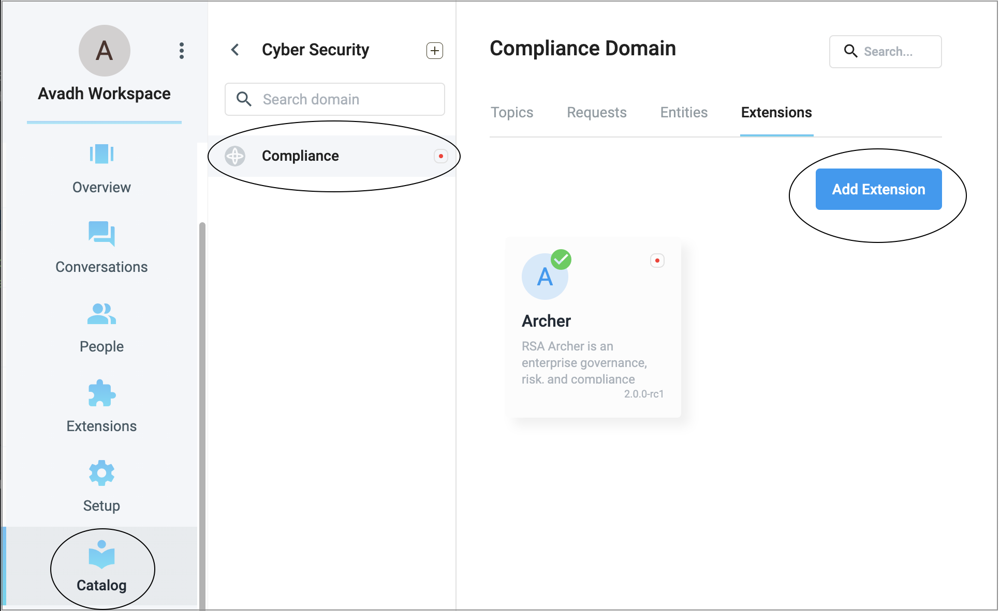
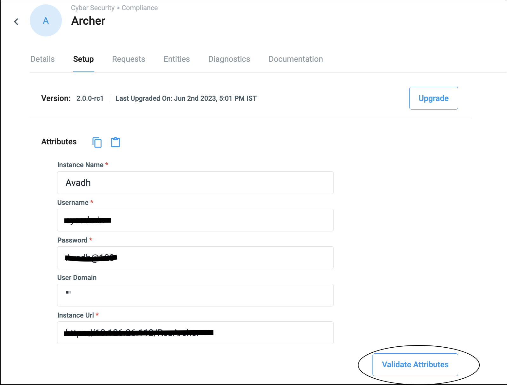
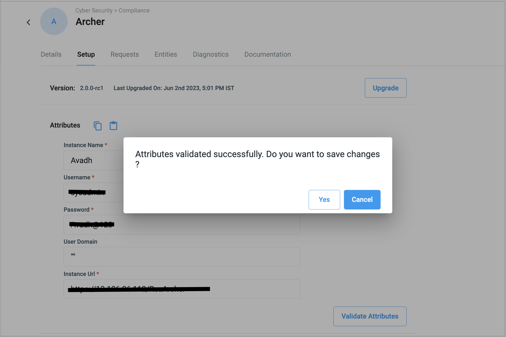

# Extension Configuration

## Overview

The Archer Extension requires configuration to connect to your RSA Archer instance. This page provides detailed
information about the configuration parameters, setup process, and troubleshooting steps to ensure a successful
connection.

## Configuration Parameters

The following parameters are required to configure the Archer Extension:

| Parameter     | Type | Required | Description                                | Example                      |
|---------------|------|----------|--------------------------------------------|------------------------------|
| Instance URL  | Text | Yes      | The base URL of your Archer instance       | `https://archer.example.com` |
| Username      | Text | Yes      | Username for authenticating with Archer    | `admin@example.com`          |
| Password      | Text | Yes      | Password for the Archer user account       | `********`                   |
| Instance Name | Text | Yes      | The name of your Archer instance           | `Production`                 |
| User Domain   | Text | No       | The domain for the user account (optional) | `CORPORATE`                  |

### Parameter Details

#### Instance URL

- **Purpose**: Specifies the base URL of your Archer instance
- **Format**: Must be a valid HTTPS URL
- **Example**: `https://archer.yourcompany.com`
- **Notes**: Do not include trailing slashes or API paths

#### Username

- **Purpose**: The username used to authenticate with Archer
- **Format**: Text string, typically an email or username
- **Example**: `service.account@company.com`
- **Notes**: Ensure the user has appropriate permissions to access the required applications and fields

#### Password

- **Purpose**: The password for the specified username
- **Format**: Text string
- **Security**: Stored securely and encrypted by Krista
- **Notes**: Use a strong password and consider using a dedicated service account

#### Instance Name

- **Purpose**: Identifies the specific Archer instance to connect to
- **Format**: Text string matching your Archer instance name
- **Example**: `Production`, `Development`, `UAT`
- **Notes**: This must match exactly with the instance name configured in Archer

#### User Domain

- **Purpose**: Specifies the domain for domain-based authentication
- **Format**: Text string representing the domain name
- **Example**: `CORPORATE`, `INTERNAL`
- **Required**: No - only needed if your Archer instance uses domain-based authentication
- **Notes**: Leave blank if not using domain authentication

## Step-by-Step Setup

Follow these steps to configure the Archer Extension in Krista:

### Step 1: Locate the Extension

1. Navigate to **Catalog → Cyber Security → Compliance → Archer**
2. Select the Archer Extension from the catalog



### Step 2: Add to Workspace

1. Click **Add to Workspace**
2. The extension setup page will open



### Step 3: Enter Configuration Parameters

Enter the appropriate values for each configuration parameter:

1. **Instance URL**: Enter your Archer instance URL (e.g., `https://archer.example.com`)
2. **Username**: Enter your Archer username
3. **Password**: Enter your Archer password
4. **Instance Name**: Enter your Archer instance name
5. **User Domain**: (Optional) Enter the user domain if applicable

### Step 4: Validate Attributes

1. Click the **Validate Attributes** button
2. The extension will attempt to connect to your Archer instance
3. A pop-up will appear asking to save the changes



### Step 5: Verify Connection

1. If validation is successful, you'll see a success message
2. The extension is now ready to use
3. You can proceed to make catalog requests

## Authentication Type

The Archer Extension uses **session-based authentication** with the following flow:

1. **Session Token Creation**: When a request is made, the extension creates a session token using your credentials
2. **Token Usage**: The session token is included in the Authorization header for API requests
3. **Automatic Retry**: If a request fails, the extension automatically retries up to 2 times
4. **Token Refresh**: A new session token is created for each request to ensure validity

### Authentication Flow

```
1. User makes a catalog request
2. Extension calls /api/core/security/login with credentials
3. Archer returns session token
4. Extension uses token in Authorization header: "Archer session-id={token}"
5. Extension makes API request to retrieve data
6. Response is returned to Krista
```

## Security Considerations

### Best Practices

1. **Use Service Accounts**
    - Create a dedicated service account for the Krista integration
    - Avoid using personal user accounts

2. **Principle of Least Privilege**
    - Grant only the minimum permissions required
    - Ensure the account can read applications and fields but not modify critical data

3. **Secure Credential Storage**
    - Krista encrypts and securely stores all credentials
    - Never share credentials or store them in plain text

4. **Regular Password Rotation**
    - Update passwords periodically according to your security policy
    - Update the extension configuration when passwords change

5. **Monitor Access**
    - Review Archer audit logs regularly
    - Monitor for unusual access patterns

6. **Network Security**
    - Ensure communication between Krista and Archer uses HTTPS
    - Configure firewall rules to allow only necessary traffic

## Troubleshooting

### Common Configuration Issues

#### Issue: "Authentication failed: Invalid username, password, or instance name"

**Cause**: Invalid credentials or incorrect instance configuration

**Resolution**:

1. Verify the username and password are correct
2. Check that the Instance Name matches your Archer instance
3. Confirm the User Domain is correct (if applicable)
4. Ensure the user account is active and not locked

#### Issue: Connection Timeout

**Cause**: Network connectivity issues or incorrect Instance URL

**Resolution**:

1. Verify the Instance URL is correct and accessible
2. Check network connectivity between Krista and Archer
3. Ensure firewall rules allow traffic on the required ports
4. Verify the Archer instance is running and accessible

#### Issue: "Authorization failed" (401 Error)

**Cause**: Insufficient permissions or expired credentials

**Resolution**:

1. Verify the user account has appropriate permissions in Archer
2. Check that the account has access to the required applications
3. Ensure the account is not locked or disabled
4. Confirm the password has not expired

#### Issue: "Bad request: One or more input parameters are invalid" (400 Error)

**Cause**: Invalid configuration parameters

**Resolution**:

1. Review all configuration parameters for typos
2. Ensure the Instance Name matches exactly
3. Verify the Instance URL format is correct
4. Check that all required fields are populated

#### Issue: "Archer server error" (500 Error)

**Cause**: Server-side error in Archer

**Resolution**:

1. Check Archer server logs for detailed error information
2. Verify the Archer instance is functioning properly
3. Contact your Archer administrator for assistance
4. Ensure the Archer API is enabled and accessible

### Validation Checklist

Before using the extension, verify:

- [ ] Instance URL is correct and accessible
- [ ] Username and password are valid
- [ ] Instance Name matches your Archer configuration
- [ ] User Domain is correct (if applicable)
- [ ] User account has necessary permissions
- [ ] Validate Attributes test passes successfully
- [ ] Network connectivity is established
- [ ] Firewall rules allow required traffic

## Next Steps

After successfully configuring the extension:

1. Review [Authentication](Authentication.md) for security details
2. Explore available [Catalog Requests](/#catalog-requests)
3. Start retrieving data from your Archer instance

## See Also

- [Authentication](pages/Authentication.md) - Authentication and security information
- [Get All Records Of Application](pages/GetAllRecordsOfApplication.md) - Retrieve application records
- [Release Notes](pages/releaseNotes.md) - Version history and updates

